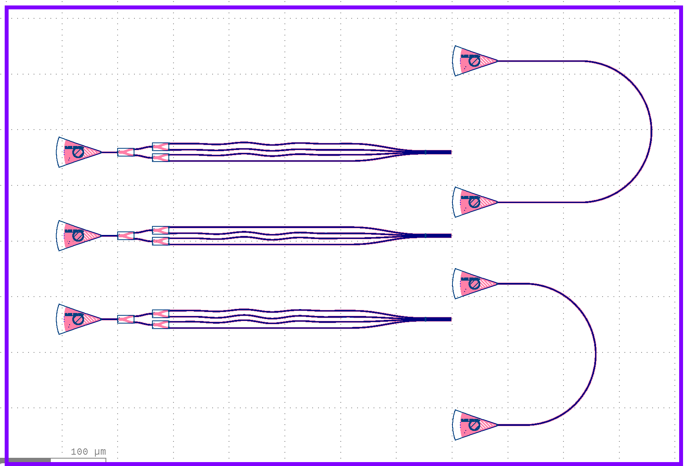
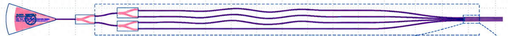
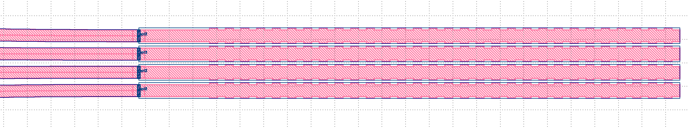

# Silicon Photonic Optical Phased Array — Layout & Verification

**Python/KLayout automation | 1550 nm silicon photonics | LiDAR-oriented passive steering**

Designed a compact silicon photonic test chip containing **three independent 1×4 optical phased arrays (OPAs)** and **two grating-coupler loopback references**. Waveguide path-length differences were designed for **−20°, 0°, and +20° lateral steering targets**.

*Actual KLayout screenshot: three OPAs (left) and two GC loopbacks (right), within a 605 × 410 µm boundary.*

## Design at a glance

| | |
|---|---|
| **Platform** | 220 nm SOI, SiEPIC EBeam PDK, TE at 1550 nm |
| **Architecture** | Three passive 1×4 splitter/delay networks; four emitters per OPA |
| **Grating emitters** | 775 nm pitch; 30 sidewall-corrugation periods; 663 nm trial period |
| **Test structures** | Two U-shaped GC loopbacks with 100 µm differential waveguide length |
| **Tools** | Python, KLayout (`pya`), SiEPIC, hierarchical GDSII, Git |

## Implementation & verification

Automated hierarchical layout generation, integrated PDK grating couplers and Y-splitters, and implemented phase-delay routing and custom emitters. Resolved component-boundary and optical-port connectivity findings during verification.

**Final merged layout:** **0 reported EBeam DRC errors** and **0 SiEPIC Functional Layout Check findings**, as checked in KLayout.

*OPA routing detail: input coupler, splitter tree and four delay-engineered waveguides.*

*Close-up of the four sidewall-corrugated emitters.*

### Two-slide overview

[View the 2-slide PowerPoint presentation](OPA_Test_Chip_Editable_Presentation.pptx)

> **Validation boundary:** The steering angles are analytical design targets, not demonstrated optical beam angles. The 663 nm antenna period and longitudinal radiation prediction have not been verified by full-wave EM simulation or experiment. Clean DRC/functional checks do **not** establish fabrication acceptance or optical performance. This portfolio documents layout design and verification; fabrication submission and device characterization are not claimed.
